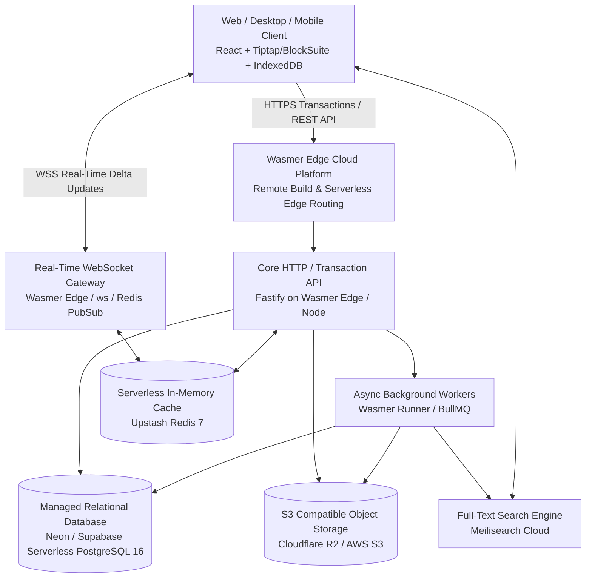
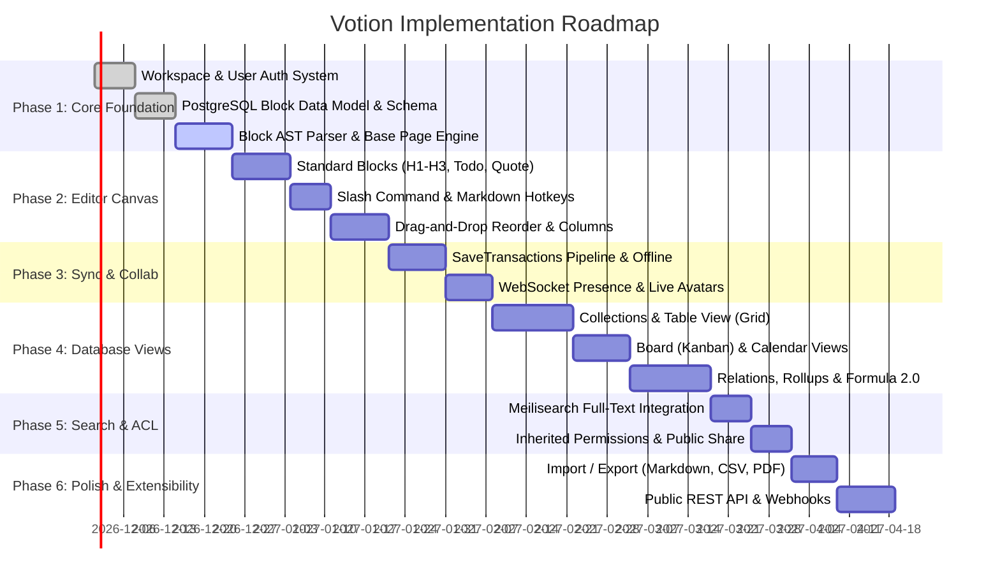

# Votion: Open-Source End-to-End Notion Architecture & Specification

> **Project Target**: An open-source, local-first capable, self-hostable, and end-to-end collaborative workspace that matches Notion's block-based paradigm, database views, relations, real-time collaboration, and extensibility.

---

## Table of Contents

1. [Executive Summary & Core Philosophy](#1-executive-summary--core-philosophy)
2. [Notion Feature Matrix & Implementation Components](#2-notion-feature-matrix--implementation-components)
   - [2.1 Editor & Block Engine](#21-editor--block-engine)
   - [2.2 Database & Data Views Engine](#22-database--data-views-engine)
   - [2.3 Workspace, Navigation & Document Management](#23-workspace-navigation--document-management)
   - [2.4 Collaboration, Real-Time Presence & Comments](#24-collaboration-real-time-presence--comments)
   - [2.5 Permissions, Sharing & Security](#25-permissions-sharing--security)
   - [2.6 Search, Indexing & Query Engine](#26-search-indexing--query-engine)
   - [2.7 Automation, Webhooks & Integrations](#27-automation-webhooks--integrations)
   - [2.8 Import, Export & Media Pipeline](#28-import-export--media-pipeline)
3. [Internal Architecture of Notion](#3-internal-architecture-of-notion)
   - [3.1 The Atomic Abstraction: Everything Is a Block](#31-the-atomic-abstraction-everything-is-a-block)
   - [3.2 The Rich Text Annotation Model](#32-the-rich-text-annotation-model)
   - [3.3 Databases Under the Hood: Collections & Views](#33-databases-under-the-hood-collections--views)
   - [3.4 Transactions & Sync Engine](#34-transactions--sync-engine)
   - [3.5 Real-Time Collaboration & Conflict Resolution](#35-real-time-collaboration--conflict-resolution)
4. [System Architecture & Topology](#4-system-architecture--topology)
   - [4.1 High-Level Component Diagram](#41-high-level-component-diagram)
   - [4.2 Client-Side Architecture](#42-client-side-architecture)
   - [4.3 Server-Side & Background Services](#43-server-side--background-services)
   - [4.4 Data Persistence & Cache Tier](#44-data-persistence--cache-tier)
5. [Database Schema & Data Model (DDL)](#5-database-schema--data-model-ddl)
   - [5.1 PostgreSQL Relational + JSONB Schema](#51-postgresql-relational--jsonb-schema)
   - [5.2 Redis In-Memory State & Pub/Sub](#52-redis-in-memory-state--pubsub)
6. [Network & Sync Protocol Specification](#6-network--sync-protocol-specification)
   - [6.1 The Transaction Protocol (`saveTransactions`)](#61-the-transaction-protocol-savetransactions)
   - [6.2 Real-Time WebSocket Channel](#62-real-time-websocket-channel)
7. [Recommended Modern Open-Source Stack](#7-recommended-modern-open-source-stack)
8. [Phased Implementation Roadmap](#8-phased-implementation-roadmap)

---

## 1. Executive Summary & Core Philosophy

Notion is not a traditional document editor or relational database wrapper. Notion is a **hybrid relational document graph**. 

The fundamental architectural principles that govern Notion are:

1. **Uniform Data Model**: Everything stored in the primary workspace tree is a **Block** (a page is a block, a text paragraph is a block, a database row is a block, an image is a block).
2. **Decoupled Data and Presentation**: Data lives in structured block records and collection tables; presentation is determined dynamically by block renderers and collection view definitions.
3. **Local-First & Optimistic Updates**: The client acts as an authoritative cache. User actions generate synchronous local UI changes and emit serializable operations (Transactions) to an offline-capable queue, which syncs asynchronously with the backend.
4. **Hierarchical Ownership & Permission Inheritance**: Every entity has a `parent_table` and `parent_id`. Permissions propagate down the structural DAG (Directed Acyclic Graph) unless overridden explicitly.

---

## 2. Notion Feature Matrix & Implementation Components

Below is the complete inventory of Notion features separated into modular implementation components, designed as actionable engineering work packages.

```
                      ┌────────────────────────────────────────┐
                      │              VOTION CORE               │
                      └───────────────────┬────────────────────┘
          ┌───────────────────────────────┼───────────────────────────────┐
          │                               │                               │
┌─────────┴─────────┐           ┌─────────┴─────────┐           ┌─────────┴─────────┐
│   Editor Engine   │           │  Database Engine  │           │  Workspace & Sync │
│  - Blocks         │           │  - Collections    │           │  - Tree Hierarchy │
│  - Rich Text      │           │  - 6 View Types   │           │  - Real-time CRDT │
│  - Drag & Drop    │           │  - Formulas & Roll│           │  - ACL Propagate  │
└───────────────────┘           └───────────────────┘           └───────────────────┘
```

---

### 2.1 Editor & Block Engine

The editor is a block-level canvas capable of horizontal multi-column splits, drag-and-drop reorganization, and nested block hierarchies.

* **Core Structural Blocks**
  * `page`: Container block with child blocks, custom cover image, icon (emoji/custom SVG), and title.
  * `text`: Standard paragraph with rich-text annotations.
  * `heading_1`, `heading_2`, `heading_3`: Semantic headers supporting folding/collapsing toggles.
  * `bulleted_list_item`, `numbered_list_item`: Indentation-aware hierarchical lists with auto-numbering.
  * `to_do`: Checkbox-enabled task items with strikethrough state transitions.
  * `toggle`: Expandable/collapsible drawer container holding arbitrary child blocks.
  * `quote`: Stylized pull quote with accent border.
  * `callout`: Container with custom emoji/icon background tint for alerts, tips, and callouts.
  * `divider`: Horizontal separator (`<hr />`).
* **Advanced & Layout Blocks**
  * `column_list` & `column`: Multi-column layout with customizable percentage-based drag resize handles.
  * `table` (Simple Table): Fixed row/column tabular matrix (not a full relational database), supporting header rows/columns.
  * `synced_block`: Single source-of-truth container whose child blocks mirror across arbitrary pages in real time.
  * `template`: One-click button that clones a preconfigured sub-tree of blocks.
  * `table_of_contents`: Auto-generated, dynamic anchor links derived from page headings.
  * `breadcrumb`: Hierarchical ancestor path navigation.
  * `math` (KaTeX): Block and inline LaTeX mathematical formula rendering.
  * `code`: Multi-language code editor with syntax highlighting, line numbers, word wrap, and clipboard copy.
* **Media & Embedded Blocks**
  * `image`, `video`, `audio`, `file`: Uploaded file attachments with progress bars, resize handles, and lightbox previews.
  * `pdf`: Embedded interactive PDF document viewer with page controls.
  * `bookmark`: Web link cards with auto-fetched OpenGraph metadata (title, description, preview image, favicon).
  * `embed`: Generic sandboxed iframe renderer with preset support for YouTube, Figma, GitHub Gists, Google Maps, Twitter/X, CodePen.
* **Editor Interactions & UX Mechanics**
  * **Slash Commands (`/`)**: Type `/` to open a filterable popup menu to convert or insert any block type.
  * **Markdown Shortcuts**: Inline parsing for `# `, `## `, `### `, `- `, `1. `, `[] `, `>`, `---`, ` ``` `, backticks for code.
  * **Block Drag-and-Drop**: Floating 6-dot drag handle on block hover. Supports reordering and vertical/horizontal drop zones.
  * **Multi-Block Selection**: Click-drag lasso or Shift+Arrow multi-block selection across block boundaries for bulk delete, move, duplicate, and indentation.
  * **Backlinks & @ Mentions**: Typing `@` opens mentions for users, dates/reminders, and pages, automatically creating bidirectional backlinks.

---

### 2.2 Database & Data Views Engine

The database engine turns ordinary pages into relational rows inside schema-backed collections.

* **Database Views (6 Core Projections)**
  * **Table View**: Spreadsheet-like grid with editable cells, column resizing, reordering, and sticky headers.
  * **Board View (Kanban)**: Card columns grouped by Select, Status, or Date with drag-and-drop column transitions and swimlanes.
  * **Calendar View**: Monthly/weekly grid displaying pages by date property with drag-and-drop rescheduling.
  * **Timeline View (Gantt)**: Interactive timeline with duration bars, dependency lines, zoom levels (hours, days, weeks, months).
  * **Gallery View**: Grid of visual cards showing page covers, embedded images, or property summaries.
  * **List View**: Minimalist vertical list for high-density document catalogs.
* **Database Property Types (Schema)**
  * **Primitive Properties**: `Title` (Primary block text), `Text`, `Number` (with currency/percent/progress-bar format), `Select` (single tagged option), `Multi-select` (array of tagged options), `Status` (To Do, In Progress, Complete with group classifications), `Date` (start date, end date, time, reminder trigger), `Checkbox`, `URL`, `Email`, `Phone`.
  * **System & Audit Properties**: `Created time`, `Created by`, `Last edited time`, `Last edited by`, `Unique ID` (prefix + auto-incrementing integer).
  * **Relational Properties**:
    * `Relation`: Foreign-key pointer connecting records across collections (one-way or bidirectional two-way link).
    * `Rollup`: Computed property looking through a Relation to extract a property and run aggregations (`Count all`, `Count unique`, `Sum`, `Average`, `Median`, `Min`, `Max`, `Percent empty`, `Percent checked`).
    * `Formula` (Formula 2.0 Engine): Turing-complete client/server expression evaluator supporting functions, regex, dates, strings, list operations (`map`, `filter`, `find`), and references to relations.
* **Query, Filter & Aggregation Layer**
  * **Compound Filters**: Nested `AND` / `OR` condition trees (`where status == 'In Progress' AND (priority == 'High' OR due_date <= today())`).
  * **Multi-Column Sorting**: Hierarchical sort rules (e.g. Sort by `Priority` ASC, then `Due Date` DESC).
  * **Grouping**: Group records by select, multi-select, date, or person with collapsible sections.
  * **Sub-items**: Hierarchical parent-child relationship within the same database table.
  * **Database Templates**: Pre-configured page templates with boilerplate block trees automatically instantiated for new rows.

---

### 2.3 Workspace, Navigation & Document Management

* **Workspace Tree Hierarchy**
  * Multi-tenant workspaces with individual workspace IDs.
  * Nested page trees of arbitrary depth (any page can contain sub-pages).
  * Teamspaces (functional groupings with specific default member access, e.g. Engineering, Design, General).
  * Private section (accessible strictly by the authenticated user).
  * Favorites / Pinned sidebar shortcuts.
* **Navigation & Shell UI**
  * Collapsible sidebar with recursive tree browser and infinite scroll.
  * Tabbed navigation (desktop and web support for opening pages in separate tabs).
  * Page breadcrumb navigation bar with quick parent jumping.
  * Trash management with soft delete (`alive: false`), search within trash, and single-click restore or permanent purge.

---

### 2.4 Collaboration, Real-Time Presence & Comments

* **Multi-User Collaboration**
  * Sub-100ms real-time synchronization of keystrokes and block structural modifications.
  * Presence indicator: Live multi-colored user avatar badges showing which block or page each user is currently focusing on.
  * Real-time cursor positions (optional visual cursor trails on canvas).
* **Discussions & Feedback**
  * Page-level top comment threads.
  * Inline text comments anchored to character spans inside rich text.
  * Comment resolution, edit history, and reaction emojis.
  * Notification inbox for `@` mentions, comment replies, and page updates.

---

### 2.5 Permissions, Sharing & Security

* **Access Control Hierarchy**
  * Workspace Owner / Admin / Member / Guest roles.
  * Granular access levels: `Full access`, `Can edit`, `Can edit content` (fill databases but not modify schemas), `Can comment`, `Can view`.
  * Public web publishing: Generates a public slug, optional search engine indexing toggle (SEO `noindex`), duplicate-as-template toggle.
  * Share links with specific email invitees or domain-restricted auto-join (e.g., anyone with `@company.com`).

---

### 2.6 Search, Indexing & Query Engine

* **Quick Find (Global Search)**
  * Instant search dialog (`Cmd/Ctrl + K` or `Cmd/Ctrl + P`).
  * Real-time prefix, tokenized full-text, and fuzzy search across:
    * Page titles and headings.
    * Text content within all block types.
    * Database property keys and string values.
  * Search filtering: Filter by Date, Created by, In Page/Sub-tree, and Document Type.
  * Recent history: Fast-access recent pages cache stored on client.

---

### 2.7 Automation, Webhooks & Integrations

* **In-Database Automations**
  * Event Triggers: `Page added`, `Property edited` (specific property value matches condition).
  * Actions: `Edit property`, `Add page to database`, `Send notification / webhook`.
* **Public Developer API**
  * REST API mirroring Notion's official OpenAPI specification (`/v1/pages`, `/v1/blocks`, `/v1/databases`, `/v1/users`, `/v1/search`).
  * Webhook subscription triggers for external workflows (e.g., Zapier, Make, n8n).

---

### 2.8 Import, Export & Media Pipeline

* **Data Ingestion (Import)**
  * Markdown (`.md`) / HTML parser converting to Notion Block AST.
  * CSV importer mapping columns to database properties.
  * Workspace archive importers (Notion JSON export, Evernote `.enex`, Trello boards).
* **Data Portability (Export)**
  * Full workspace or single-page export to Markdown + CSV (zip archive).
  * Clean HTML export with bundled asset folders.
  * Pixel-perfect PDF generation using headless Chromium.

---

## 3. Internal Architecture of Notion

Notion's underlying engineering is distinguished by its record store architecture, transaction engine, and unified block graph.

### 3.1 The Atomic Abstraction: Everything Is a Block

In Notion's data layer, there are no separate tables for "Articles", "Folders", "Comments", or "Tasks". The fundamental entity is a **Record**, categorized into core tables: `block`, `collection`, `collection_view`, `space`, and `notion_user`.

#### Canonical Block Data Schema (JSON)
```json
{
  "id": "a1b2c3d4-e5f6-7a8b-9c0d-1e2f3a4b5c6d",
  "version": 42,
  "type": "text",
  "properties": {
    "title": [
      ["Hello "],
      ["world", [["b"], ["c", "blue"]]],
      ["!"]
    ]
  },
  "content": [
    "child-block-uuid-1",
    "child-block-uuid-2"
  ],
  "format": {
    "block_color": "gray_background",
    "block_width": null
  },
  "parent_id": "0f1e2d3c-4b5a-6978-8a9b-cdef01234567",
  "parent_table": "block",
  "alive": true,
  "created_time": 1716300000000,
  "last_edited_time": 1716300050000,
  "created_by_id": "user-uuid-1",
  "last_edited_by_id": "user-uuid-1",
  "space_id": "workspace-uuid-1"
}
```

* **`id`**: Canonical UUIDv4.
* **`type`**: Determines how the frontend component renders this block and what sub-properties it expects.
* **`properties`**: The content payloads (for a text block, its rich text; for a code block, code and language; for a database row, its column values keyed by schema ID).
* **`content`**: An ordered array of UUIDs representing the child blocks of this block. **Hierarchy is modeled as an ordered parent-child link list.**
* **`parent_table` & `parent_id`**: Establishes upward graph traversal (`parent_table` can be `block`, `collection`, `space`).
* **`alive`**: Boolean flag. Notion never executes hard SQL `DELETE` during user operations; it updates `alive: false`.

---

### 3.2 The Rich Text Annotation Model

Notion stores formatted strings as a compact nested array of segments with style descriptors:

$$\text{RichText} = \text{Array}<\left[\text{TextString}, \text{Array}<\text{Modifier}>\right]>$$

```json
[
  ["Bold and Italic text", [["b"], ["i"]]],
  [" Normal text "],
  ["inline code", [["c"]]],
  ["link to site", [["a", "https://github.com"]]],
  ["user mention", [["u", "user-uuid-1"]]],
  ["page mention", [["p", "page-uuid-2"]]],
  ["date mention", [["d", {"type": "date", "start_date": "2026-11-21"}]]]
]
```

Modifier symbols:
* `b`: Bold
* `i`: Italic
* `s`: Strikethrough
* `_`: Underline
* `c`: Inline Code
* `h`: Color / Highlight (`["h", "red"]`, `["h", "yellow_background"]`)
* `a`: Hyperlink (`["a", "https://..."]`)
* `e`: Inline KaTeX Equation (`["e", "E=mc^2"]`)
* `u`, `p`, `d`: Mentions (User, Page, Date)

---

### 3.3 Databases Under the Hood: Collections & Views

A database in Notion is not an SQL table created at runtime. It is a pair of abstractions:
1. **`collection`**: Represents the schema definition and metadata.
2. **`collection_view`**: Represents the projection query, sorting, filtering, groupings, and visual mode.
3. **`block` (type: `page`)**: The rows! Every row in a database is an ordinary `page` block whose `parent_id` is the `collection_id` and `parent_table` is `collection`.

```
                    ┌────────────────────────────┐
                    │  Block (type: collection)  │
                    │   Acts as canvas container │
                    └─────────────┬──────────────┘
                                  │ owns
         ┌────────────────────────┴────────────────────────┐
         ▼                                                 ▼
┌──────────────────┐                             ┌───────────────────┐
│    Collection    │                             │  Collection Views │
│ - Schema keys    │                             │ - Table View      │
│ - Property types │                             │ - Kanban View     │
│ - Options        │                             │ - Filters & Sorts │
└────────┬─────────┘                             └───────────────────┘
         │ parent of
         ├──► Block (type: page) [Row 1] -> properties: { "title": ..., "prop_priority": "High" }
         ├──► Block (type: page) [Row 2] -> properties: { "title": ..., "prop_priority": "Low" }
         └──► Block (type: page) [Row 3] -> properties: { "title": ..., "prop_priority": "Medium" }
```

#### Collection Schema JSON
```json
{
  "id": "coll-uuid-1",
  "name": [["Sprint Tasks"]],
  "schema": {
    "title": { "name": "Task Name", "type": "title" },
    "prop_status": {
      "name": "Status",
      "type": "status",
      "options": [
        { "id": "s1", "value": "To Do", "color": "default" },
        { "id": "s2", "value": "In Progress", "color": "blue" },
        { "id": "s3", "value": "Done", "color": "green" }
      ]
    },
    "prop_rel_project": {
      "name": "Project",
      "type": "relation",
      "collection_id": "coll-projects-uuid"
    }
  }
}
```

---

### 3.4 Transactions & Sync Engine

Notion does not use standard REST resource updates (e.g. `PATCH /blocks/:id`). Instead, Notion uses a **Command Pattern Transaction Queue**.

Every mutation on the client emits an atomic batch of operations:
```json
{
  "operations": [
    {
      "pointer": { "table": "block", "id": "block-uuid-123" },
      "path": ["properties", "title"],
      "command": "set",
      "args": [["Updated Document Title"]]
    },
    {
      "pointer": { "table": "block", "id": "parent-page-uuid" },
      "path": ["content"],
      "command": "listAfter",
      "args": { "after": "prev-block-uuid", "id": "block-uuid-123" }
    }
  ]
}
```

#### Core Operational Commands
* `set`: Overwrites the object at `path` with `args`.
* `update`: Merges dictionary keys at `path` with `args`.
* `listAfter`: Inserts an element into an ordered array at `path` after a specific ID.
* `listBefore`: Inserts an element into an ordered array before a specific ID.
* `listRemove`: Removes an item from an array at `path`.
* `keyedObjectSet`: Sets a specific key inside a map without replacing other keys.

---

### 3.5 Real-Time Collaboration & Conflict Resolution

#### How Notion Solves Concurrency:
1. **Granular Path Updates**: Because operations specify precise paths (`["properties", "title"]` vs `["format", "block_color"]`), concurrent changes to different properties of the same block do not overwrite each other.
2. **List Ordering**: Insertion into child arrays uses relative reference IDs (`listAfter: target_id`) rather than numerical array indexes (`insert at index 3`), eliminating index shifting collisions.
3. **Last-Write-Wins (LWW) with Version Check**: Individual fields resolve via server timestamp ordering.
4. **Modern Open-Source Implementation (CRDT)**: For building an open-source equivalent, pure path LWW can still produce conflicts on simultaneous character-level typing in the exact same paragraph. Thus, **Votion** will combine:
   * **Yjs (Y.Doc / Y.Array / Y.Text)** or **BlockSuite** for conflict-free character and block ordering.
   * Granular PostgreSQL transactions for persistent state durability.

---

## 4. System Architecture & Topology

### 4.1 High-Level Component Diagram



---

### 4.2 Client-Side Architecture

The client is built around an **Optimistic Local Cache**:

```
 ┌─────────────────────────────────────────────────────────────┐
 │                      VOTION CLIENT                          │
 │                                                             │
 │  ┌─────────────────┐       ┌─────────────────────────────┐  │
 │  │ Editor UI Layer │ <---> │  Client Memory Record Store │  │
 │  │ (Block Renderer)│       │  (Zustand / Jotai / Signals)│  │
 │  └────────┬────────┘       └──────────────┬──────────────┘  │
 │           │                               ▲                 │
 │           ▼ User Action                   │ Synchronize     │
 │  ┌─────────────────┐       ┌──────────────┴──────────────┐  │
 │  │ Mutation Engine │ ----> │     Local Persistent DB     │  │
 │  │ (Produces Txns) │       │   (IndexedDB via Dexie.js)  │  │
 │  └────────┬────────┘       └─────────────────────────────┘  │
 │           │                               ▲                 │
 │           ▼ Queue                         │ Updates         │
 │  ┌────────────────────────────────────────┴──────────────┐  │
 │  │               Sync Manager & Socket Client            │  │
 │  └────────────────────────────┬──────────────────────────┘  │
 └───────────────────────────────┼─────────────────────────────┘
                                 │ HTTPS / WSS
                                 ▼
                         Backend Services
```

1. **State Store**: Normalizes records into hash maps (`blocks: Record<string, Block>`, `collections: Record<string, Collection>`).
2. **Local Persistence (IndexedDB)**: Caches workspaces locally. The user can navigate, read, and write completely offline.
3. **Offline Outbox Queue**: Failed or pending transactions are preserved in IndexedDB and replayed in strict sequence upon reconnect.

---

### 4.3 Server-Side & Background Services

* **API Application Server**:
  * Implements `POST /api/v3/saveTransactions`.
  * Verifies workspace authorization and entity permissions.
  * Validates transaction schema and writes to PostgreSQL within atomic database transactions.
  * Emits record change notifications to Redis channel (`workspace:{space_id}`).
* **WebSocket Real-Time Gateway**:
  * Maintains persistent connections with active clients.
  * Handles room management (`page:{page_id}` and `space:{space_id}`).
  * Relays ephemeral presence states (mouse coordinates, active block selection) without hitting the persistent database.
  * Broadcasts transaction invalidations to subscribed peers.
* **Background Worker Fleet**:
  * Handles heavy and asynchronous operations:
    * Cascading permission inheritance changes across large sub-trees.
    * Recursive soft-deletion and trash purging.
    * Rollup recalculations when related collection rows change.
    * Webhook and automation execution.
    * File and image thumbnail generation, PDF rendering.
    * Ingestion of block text into Meilisearch.

---

### 4.4 Data Persistence & Cache Tier

* **PostgreSQL (Neon / Supabase Serverless)**: The single source of truth for all record tables. Sharded or partitioned by `space_id` (Workspace) to enable horizontal scaling without running database containers.
* **Redis (Upstash / Redis Cloud)**:
  * Fast caching of user sessions and record reads (`GET /loadUserContent`).
  * Distributed locks for concurrent transaction serialization where needed.
  * Pub/Sub messaging bus bridging the HTTP API servers and WebSocket servers.
* **Cloudflare R2 / AWS S3**: Immutable S3-compatible cloud storage for media uploads, attachments, avatars, and page export bundles with zero egress fees (R2).

---

## 5. Database Schema & Data Model (DDL)

### 5.1 PostgreSQL Relational + JSONB Schema

```sql
-- Enable necessary extensions
CREATE EXTENSION IF NOT EXISTS "uuid-ossp";
CREATE EXTENSION IF NOT EXISTS "pgcrypto";

-- Workspaces (Spaces in Notion terminology)
CREATE TABLE workspaces (
    id UUID PRIMARY KEY DEFAULT gen_random_uuid(),
    name VARCHAR(255) NOT NULL,
    domain VARCHAR(64) UNIQUE,
    icon TEXT,
    plan VARCHAR(32) DEFAULT 'free',
    created_at TIMESTAMPTZ DEFAULT NOW(),
    updated_at TIMESTAMPTZ DEFAULT NOW()
);

-- Users
CREATE TABLE users (
    id UUID PRIMARY KEY DEFAULT gen_random_uuid(),
    email VARCHAR(255) UNIQUE NOT NULL,
    password_hash TEXT,
    full_name VARCHAR(255) NOT NULL,
    avatar_url TEXT,
    created_at TIMESTAMPTZ DEFAULT NOW(),
    updated_at TIMESTAMPTZ DEFAULT NOW()
);

-- Workspace Membership & RBAC
CREATE TABLE workspace_members (
    workspace_id UUID REFERENCES workspaces(id) ON DELETE CASCADE,
    user_id UUID REFERENCES users(id) ON DELETE CASCADE,
    role VARCHAR(32) NOT NULL DEFAULT 'member', -- owner, admin, member, guest
    created_at TIMESTAMPTZ DEFAULT NOW(),
    PRIMARY KEY (workspace_id, user_id)
);

-- Unified Block Table (Core Entity)
CREATE TABLE blocks (
    id UUID PRIMARY KEY DEFAULT gen_random_uuid(),
    space_id UUID NOT NULL REFERENCES workspaces(id) ON DELETE CASCADE,
    version INT NOT NULL DEFAULT 1,
    type VARCHAR(64) NOT NULL,
    
    -- Content & Attributes
    properties JSONB DEFAULT '{}'::jsonb,  -- Rich text, checked status, language, etc.
    format JSONB DEFAULT '{}'::jsonb,      -- Cover image, icon, color, width, etc.
    content UUID[] DEFAULT ARRAY[]::UUID[], -- Ordered array of child block IDs
    
    -- Graph Relationships & Hierarchy
    parent_id UUID NOT NULL,
    parent_table VARCHAR(32) NOT NULL,     -- 'block', 'collection', 'space'
    alive BOOLEAN NOT NULL DEFAULT TRUE,   -- Soft deletion
    
    -- Audit Metadata
    created_time TIMESTAMPTZ DEFAULT NOW(),
    last_edited_time TIMESTAMPTZ DEFAULT NOW(),
    created_by_id UUID REFERENCES users(id),
    last_edited_by_id UUID REFERENCES users(id)
);

-- Indexes for lightning-fast block tree lookups
CREATE INDEX idx_blocks_space_id ON blocks(space_id);
CREATE INDEX idx_blocks_parent_id ON blocks(parent_id);
CREATE INDEX idx_blocks_alive ON blocks(alive);
CREATE INDEX idx_blocks_type ON blocks(type);
CREATE INDEX idx_blocks_properties_gin ON blocks USING gin(properties);

-- Collections (Database Definitions)
CREATE TABLE collections (
    id UUID PRIMARY KEY DEFAULT gen_random_uuid(),
    space_id UUID NOT NULL REFERENCES workspaces(id) ON DELETE CASCADE,
    parent_id UUID NOT NULL,
    name JSONB NOT NULL DEFAULT '[]'::jsonb,       -- RichText array
    description JSONB DEFAULT '[]'::jsonb,
    schema JSONB NOT NULL DEFAULT '{}'::jsonb,     -- Map of propertyId -> PropertySchema
    icon TEXT,
    cover TEXT,
    alive BOOLEAN NOT NULL DEFAULT TRUE,
    version INT NOT NULL DEFAULT 1,
    created_at TIMESTAMPTZ DEFAULT NOW(),
    updated_at TIMESTAMPTZ DEFAULT NOW()
);

CREATE INDEX idx_collections_space_id ON collections(space_id);
CREATE INDEX idx_collections_schema_gin ON collections USING gin(schema);

-- Collection Views (View Projections & Filters)
CREATE TABLE collection_views (
    id UUID PRIMARY KEY DEFAULT gen_random_uuid(),
    space_id UUID NOT NULL REFERENCES workspaces(id) ON DELETE CASCADE,
    collection_id UUID NOT NULL REFERENCES collections(id) ON DELETE CASCADE,
    type VARCHAR(32) NOT NULL, -- table, board, calendar, timeline, gallery, list
    name VARCHAR(255) NOT NULL,
    format JSONB DEFAULT '{}'::jsonb, -- Column widths, card preview settings, board groups
    query2 JSONB DEFAULT '{}'::jsonb,  -- Aggregations, filters, sort orders
    alive BOOLEAN NOT NULL DEFAULT TRUE,
    version INT NOT NULL DEFAULT 1,
    created_at TIMESTAMPTZ DEFAULT NOW(),
    updated_at TIMESTAMPTZ DEFAULT NOW()
);

CREATE INDEX idx_collection_views_coll_id ON collection_views(collection_id);

-- Explicit Permissions / Overrides
CREATE TABLE permissions (
    id UUID PRIMARY KEY DEFAULT gen_random_uuid(),
    workspace_id UUID NOT NULL REFERENCES workspaces(id) ON DELETE CASCADE,
    entity_table VARCHAR(32) NOT NULL, -- 'block', 'space'
    entity_id UUID NOT NULL,
    principal_type VARCHAR(32) NOT NULL, -- 'user', 'teamspace', 'public'
    principal_id UUID, -- NULL if public
    role VARCHAR(32) NOT NULL, -- 'read', 'comment', 'write', 'admin'
    created_at TIMESTAMPTZ DEFAULT NOW()
);

CREATE INDEX idx_permissions_entity ON permissions(entity_table, entity_id);

-- Transaction Audit & WAL (Write-Ahead Log for sync and recovery)
CREATE TABLE transaction_records (
    id BIGSERIAL PRIMARY KEY,
    space_id UUID NOT NULL,
    user_id UUID NOT NULL REFERENCES users(id),
    operations JSONB NOT NULL,
    created_at TIMESTAMPTZ DEFAULT NOW()
);

CREATE INDEX idx_tx_records_space_created ON transaction_records(space_id, created_at);
```

---

## 6. Network & Sync Protocol Specification

### 6.1 The Transaction Protocol (`saveTransactions`)

When a user performs any action (edits text, drags a block, renames a column), the client dispatches an HTTP `POST /api/v3/saveTransactions` endpoint:

#### Request Body
```json
{
  "requestId": "req-9876-uuid",
  "transactions": [
    {
      "id": "tx-1234-uuid",
      "spaceId": "38a8e10b-47e4-4d89-b14e-b86a8ff35df1",
      "operations": [
        {
          "pointer": {
            "table": "block",
            "id": "76ef2b14-8c8f-402a-9e12-32b036ca6d5f",
            "spaceId": "38a8e10b-47e4-4d89-b14e-b86a8ff35df1"
          },
          "path": ["properties", "title"],
          "command": "set",
          "args": [["Updated Document Title"]]
        },
        {
          "pointer": {
            "table": "block",
            "id": "76ef2b14-8c8f-402a-9e12-32b036ca6d5f",
            "spaceId": "38a8e10b-47e4-4d89-b14e-b86a8ff35df1"
          },
          "path": ["last_edited_time"],
          "command": "set",
          "args": 1716300050000
        }
      ]
    }
  ]
}
```

#### Server Processing Lifecycle
1. **Auth & ACL Check**: Verify `user_id` has write privileges on target `block.id`.
2. **Atomic Execution**: In an SQL transaction:
   * Fetch current `version` of target record.
   * Apply operations directly via PostgreSQL `jsonb_set` or object reconstitution.
   * Increment `version = version + 1`.
   * Insert entry into `transaction_records`.
3. **Publish Invalidation**: Emit payload onto Redis Pub/Sub topic `channel:space:<space_id>`.
4. **200 OK Response**: Return updated version numbers to caller.

---

### 6.2 Real-Time WebSocket Channel

Clients maintain a WebSocket connection to `wss://api.votion.dev/socket.io/`.

#### Client Subscribes to Records
```json
{
  "action": "subscribe",
  "subscriptions": [
    { "table": "block", "id": "page-uuid-1" },
    { "table": "collection", "id": "coll-uuid-1" }
  ]
}
```

#### Ephemeral Presence Message (Cursor & Selection)
```json
{
  "type": "presence",
  "pageId": "page-uuid-1",
  "userId": "user-uuid-1",
  "cursor": { "x": 320, "y": 485 },
  "activeBlockId": "block-uuid-5",
  "selectedRange": { "start": 0, "end": 14 }
}
```

#### Server Broadcasts Remote Mutation
```json
{
  "type": "record_updated",
  "table": "block",
  "id": "76ef2b14-8c8f-402a-9e12-32b036ca6d5f",
  "version": 43,
  "patch": {
    "properties": {
      "title": [["Updated Document Title"]]
    }
  }
}
```

---

## 7. Recommended Modern Open-Source Stack

To build **Votion** cleanly, reliably, and with enterprise-grade performance, the following battle-tested open-source components are selected:

| Architectural Role | Recommended Technology | Justification |
| :--- | :--- | :--- |
| **Frontend Framework** | **Next.js (App Router) + React + TypeScript** | Server-side rendering for public pages; fast client hydration; type safety. |
| **Styling & Components**| **Tailwind CSS + Radix UI + shadcn/ui** | Headless accessible primitives with complete aesthetic control over Notion's subtle UI. |
| **Rich Text & Editor Engine**| **Tiptap (ProseMirror)** or **BlockSuite (Affine Engine)** | BlockSuite is purpose-built for Notion-like block canvases with built-in CRDT (Yjs). Tiptap provides granular control. |
| **Client State & Cache**| **Zustand + Dexie.js (IndexedDB)** | Minimalist in-memory state store with persistent, indexed browser storage. |
| **Backend API Server** | **Node.js (Fastify) or Go (Fiber/Chi)** | Extremely high throughput for processing JSON transaction streams. |
| **Real-time Server** | **Node.js with `ws` / `Socket.io` or Go Channels** | WebSocket connection multiplexer. |
| **Primary Database** | **PostgreSQL 16** | Unrivaled JSONB support, ACID transactions, relational integrity for permissions, extensions (`pgvector`, `pgcrypto`). |
| **In-Memory Cache & Pub/Sub**| **Redis 7 (Valkey)** | Ephemeral presence, pub/sub message distribution across horizontally scaled API nodes. |
| **Search Engine** | **Meilisearch** | Lightning-fast typo-tolerant full-text search with instant filtering out-of-the-box. |
| **Object Storage** | **Cloudflare R2 / AWS S3** | S3-compatible cloud object storage with zero egress fees (Cloudflare R2) or AWS S3. |
| **Edge & Cloud Deployment** | **Wasmer Edge (`wasmer deploy --build-remote`)** | WebAssembly & edge application platform. Zero-Docker deployment powered by `wasmer.toml` and remote building. |

### 7.1 Wasmer Deployment Pipeline

Votion avoids containerization overhead and Docker daemon dependencies by utilizing **Wasmer Edge** with remote builds:

```bash
# Set deployment authentication token (store securely in your environment / CI secrets)
export WASMER_TOKEN="<YOUR_WASMER_TOKEN>"

# Execute remote build and zero-downtime deployment
~/.wasmer/bin/wasmer deploy --build-remote
```

#### Wasmer Package Configuration (`wasmer.toml`)
```toml
[package]
name = "votion/votion-app"
version = "0.1.0"
description = "Votion: Open-Source Notion Clone on Wasmer Edge"

[[services]]
name = "web"
kind = "http"
runner = "https://webc.org/runner/node"

[services.annotations]
routes = ["/*"]

[env]
DATABASE_URL = { secret = "DATABASE_URL" }
REDIS_URL = { secret = "REDIS_URL" }
S3_ENDPOINT = { secret = "S3_ENDPOINT" }
S3_BUCKET = "votion-media"
```

---

## 8. Phased Implementation Roadmap



### Phase 1: Core Foundation & Data Engine (Weeks 1–3)
- [ ] Set up monorepo (`apps/web`, `apps/server`, `packages/shared-types`).
- [ ] Implement database schema in PostgreSQL (`workspaces`, `users`, `blocks`, `permissions`).
- [ ] Implement `Block` CRUD endpoints with parent-child relationship validation.
- [ ] Establish client-side state store and IndexedDB cache with Dexie.js.

### Phase 2: Editor Canvas & Block Interactions (Weeks 4–6)
- [ ] Mount block-based editor canvas (using BlockSuite or ProseMirror/Tiptap).
- [ ] Implement core blocks: Text, Heading (1, 2, 3), Toggle, Bulleted/Numbered List, To-do, Quote, Callout, Divider.
- [ ] Build `/` Slash Menu with quick search and block conversion.
- [ ] Implement Markdown auto-formatting triggers.
- [ ] Implement 6-dot floating drag handle with drag-and-drop reordering and multi-column support (`column_list`, `column`).

### Phase 3: Transactions, Offline Engine & Real-Time Sync (Weeks 7–9)
- [ ] Implement `saveTransactions` engine with operation primitives (`set`, `update`, `listAfter`, `listRemove`).
- [ ] Connect WebSocket server to Redis Pub/Sub for cross-client update broadcasting.
- [ ] Build multi-user presence indicators (colored user avatars and active block rings).
- [ ] Implement offline transaction outbox queue that syncs automatically on network reconnection.

### Phase 4: Databases, Custom Views & Relations (Weeks 10–13)
- [ ] Implement `collections` and `collection_views` schema.
- [ ] Build **Table View** (spreadsheet grid with inline cells and column resize).
- [ ] Build **Board View** (Kanban with drag-and-drop between status/select columns).
- [ ] Build **Calendar** and **Gallery** views.
- [ ] Implement filter builder (`AND`/`OR` tree) and multi-level sort engine.
- [ ] Implement Relational properties (linking pages between databases).
- [ ] Implement Rollups and Formula evaluator.

### Phase 5: Search, Permissions & Collaboration Tools (Weeks 14–16)
- [ ] Integrate Meilisearch with background worker queue for real-time document indexing.
- [ ] Implement `Cmd+K` Quick Find modal with instant search and filter pills.
- [ ] Implement page tree permission inheritance and granular role overrides.
- [ ] Build public page publishing with customizable slugs.
- [ ] Inline text comment anchor system and page discussion thread.

### Phase 6: Extensibility, Portability & Production Hardening (Weeks 17–18)
- [ ] Import pipeline: Markdown, HTML, CSV.
- [ ] Export pipeline: Markdown + CSV zip bundle and PDF generation.
- [ ] Public REST API v1 mirroring standard Notion endpoints.
- [ ] Wasmer Edge deployment configuration (`wasmer.toml`) and automated remote build pipeline via `wasmer deploy --build-remote`.
