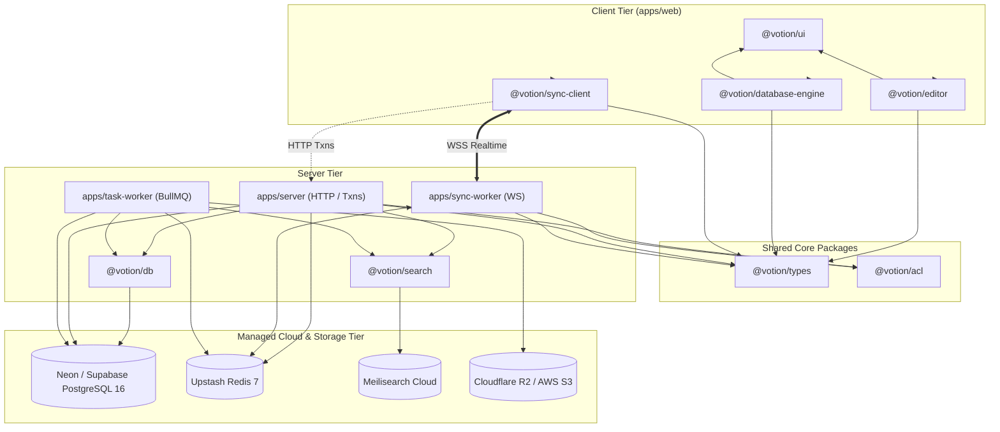

# Votion: Engineering Component Decomposition & Specification

> **Companion Document**: Complements [Architecture.md](file:///home/nexuss0781/Desktop/Nex/Votion/Architecture.md).  
> **Purpose**: Translates the high-level system architecture into concrete, modular, implementable software engineering components, monorepo packages, state contracts, and inter-component communication interfaces.

---

## Table of Contents

1. [Monorepo Package Structure](#1-monorepo-package-structure)
2. [Component Interdependency Graph](#2-component-interdependency-graph)
3. [Subsystem 1: Editor & Canvas Subsystem (`@votion/editor`)](#3-subsystem-1-editor--canvas-subsystem-votioneditor)
4. [Subsystem 2: Database & Collection Subsystem (`@votion/database-engine`)](#4-subsystem-2-database--collection-subsystem-votiondatabase-engine)
5. [Subsystem 3: Client State, Cache & Sync Subsystem (`@votion/sync-client`)](#5-subsystem-3-client-state-cache--sync-subsystem-votionsync-client)
6. [Subsystem 4: Backend API & Transaction Server (`@votion/server`)](#6-subsystem-4-backend-api--transaction-server-votionserver)
7. [Subsystem 5: Real-Time & Collaboration Gateway (`@votion/sync-worker`)](#7-subsystem-5-real-time--collaboration-gateway-votionsync-worker)
8. [Subsystem 6: Permission & Access Control Subsystem (`@votion/acl`)](#8-subsystem-6-permission--access-control-subsystem-votionacl)
9. [Subsystem 7: Search & Indexing Subsystem (`@votion/search`)](#9-subsystem-7-search--indexing-subsystem-votionsearch)
10. [Subsystem 8: Async Worker & Job Fleet (`@votion/task-worker`)](#10-subsystem-8-async-worker--job-fleet-votiontask-worker)
11. [Subsystem 9: Public Developer API & Automations (`@votion/api-gateway`)](#11-subsystem-9-public-developer-api--automations-votionapi-gateway)
12. [Data Contracts & Core TypeScript Interfaces (`@votion/types`)](#12-data-contracts--core-typescript-interfaces-votiontypes)

---

## 1. Monorepo Package Structure

The codebase is organized as a high-performance TypeScript monorepo managed with Turborepo and pnpm workspaces:

```
votion/
├── apps/
│   ├── web/                     # Next.js 14+ Frontend Application (App Router)
│   ├── server/                  # Core HTTP & Transaction API (Node.js Fastify)
│   ├── sync-worker/             # WebSocket Presence & Realtime Gateway
│   └── task-worker/             # Asynchronous Queue Consumers (BullMQ)
│
├── packages/
│   ├── types/                   # Canonical TypeScript Interfaces & Enums
│   ├── editor/                  # Block-based Canvas & ProseMirror/BlockSuite Adapter
│   ├── database-engine/         # Collection Views, Filters, Sorts & Formula Evaluator
│   ├── sync-client/             # Optimistic Local Store, IndexedDB & Outbox Queue
│   ├── db/                      # PostgreSQL Schema, Migrations & Drizzle/Kysely Client
│   ├── acl/                     # Permission Graph Traverser & Authorization Middleware
│   ├── search/                  # Meilisearch Client & Query Builder
│   └── ui/                      # Shared Tailwind + Radix UI Component Library
│
├── tooling/
│   ├── eslint-config/           # Shared Linting Rules
│   ├── typescript-config/       # Base tsconfig.json configurations
│   └── wasmer/                  # Wasmer Edge deployment configurations & routing
│
├── wasmer.toml                  # Wasmer Edge Application Manifest
├── Architecture.md              # System Architecture Specification
├── Components.md                # This Component Decomposition Document
└── package.json                 # Monorepo Workspace Root
```

---

## 2. Component Interdependency Graph



---

## 3. Subsystem 1: Editor & Canvas Subsystem (`@votion/editor`)

The Editor Canvas provides the block-based editing experience, handling rendering, layout trees, rich-text input, and drag-and-drop interactions.

```
@votion/editor/
├── src/
│   ├── components/
│   │   ├── BlockCanvas.tsx           # Top-level page block renderer
│   │   ├── BlockWrapper.tsx          # Handles 6-dot handle, hover states, selection
│   │   ├── ColumnLayout.tsx          # Multi-column grid with resizers
│   │   └── SlashMenu.tsx             # '/' popover block catalog
│   ├── blocks/
│   │   ├── TextBlock.tsx             # Paragraph block
│   │   ├── HeadingBlock.tsx          # H1, H2, H3 with toggle collapse
│   │   ├── TodoBlock.tsx             # Checkbox to-do block
│   │   ├── ToggleBlock.tsx           # Expandable drawer container
│   │   ├── CodeBlock.tsx             # Syntax highlighted code editor
│   │   ├── CalloutBlock.tsx          # Icon + background tint container
│   │   ├── MediaBlock.tsx            # Image/Video/Audio/File with resize handles
│   │   └── SyncedBlock.tsx           # Dynamic pointer to master block tree
│   ├── richtext/
│   │   ├── RichTextRenderer.tsx      # Renders [string, modifier[]][]
│   │   ├── InlineFormatting.ts       # Bold, Italic, Strikethrough, Color, Link
│   │   └── MentionParser.ts          # @ user, @ page, @ date resolver
│   ├── dnd/
│   │   ├── DragManager.ts            # Pointer sensor & drop target locator
│   │   └── DropIndicator.tsx         # Visual insertion bar (horizontal/vertical)
│   ├── selection/
│   │   └── MultiBlockSelection.ts    # Box selection & multi-block range highlights
│   └── shortcuts/
│       └── MarkdownShortcuts.ts      # Inline markdown triggers ('#', '-', '[]')
```

### Engineering Responsibilities
1. **Block Tree Traversal**: Recursively renders blocks starting from the root page block's `content: string[]` array of UUIDs.
2. **Path-Based Change Emission**: Emits fine-grained transaction operations whenever properties change (e.g., typing updates `["properties", "title"]`).
3. **Relative Drop Target Math**: Drag-and-drop computes relative placements (`listAfter(targetId)` or `listBefore(targetId)`) and handles column-splitting thresholds.
4. **Rich Text Spans**: Manages non-destructive inline styling without splitting blocks into HTML soup.

---

## 4. Subsystem 2: Database & Collection Subsystem (`@votion/database-engine`)

Responsible for the relational database capabilities of Notion: schemas, dynamic views, sorting, filtering, formulas, and rollups.

```
@votion/database-engine/
├── src/
│   ├── views/
│   │   ├── TableView/
│   │   │   ├── TableHeader.tsx       # Draggable, resizable column headers
│   │   │   ├── TableRow.tsx          # Page row mapped to schema cells
│   │   │   └── CellRenderer.tsx      # Type-specific cell inputs
│   │   ├── BoardView/                # Kanban grouped by Select/Status
│   │   ├── CalendarView/             # Month/week grid by Date property
│   │   ├── TimelineView/             # Gantt bars with dependency links
│   │   ├── GalleryView/              # Card grid with preview covers
│   │   └── ListView/                 # Minimal high-density document list
│   ├── schema/
│   │   ├── PropertyRegistry.ts       # Type metadata, default values, validators
│   │   └── SchemaManager.ts          # Add, rename, delete, reorder schema columns
│   ├── query/
│   │   ├── FilterEvaluator.ts        # Recursive AND/OR filter tree evaluator
│   │   ├── SortEngine.ts             # Multi-property sort comparator
│   │   ├── GroupingEngine.ts         # Bucket pages into columns or swimlanes
│   │   └── Aggregator.ts             # Sum, Avg, Min, Max, Count calculations
│   ├── formula/
│   │   ├── Lexer.ts                  # Tokenizes Formula 2.0 expressions
│   │   ├── Parser.ts                 # Builds AST (Abstract Syntax Tree)
│   │   ├── Evaluator.ts              # Evaluates AST against record context
│   │   └── StandardLibrary.ts        # Built-in math, string, date, list functions
│   └── relation/
│       ├── RelationResolver.ts       # Resolves two-way and one-way foreign keys
│       └── RollupEngine.ts           # Traverses relation graph to compute rollups
```

### Key Logic & Algorithms
* **Formula 2.0 AST Evaluator**:
  ```
  Input: "prop('Price') * (1 - prop('Discount') / 100)"
  Tokens: [PROP('Price'), MULTIPLY, LPAREN, NUMBER(1), MINUS, ...]
  AST: BinaryExpr(MULTIPLY, PropRef('Price'), BinaryExpr(MINUS, Number(1), ...))
  Output: Numeric evaluation for each row in O(1) runtime.
  ```
* **Filter Evaluator**: Implements standard Boolean logic AST:
  ```typescript
  type FilterClause = 
    | { property: string; operator: 'equals' | 'contains' | 'is_empty' | 'greater_than'; value: any }
    | { operator: 'and' | 'or'; filters: FilterClause[] };
  ```

---

## 5. Subsystem 3: Client State, Cache & Sync Subsystem (`@votion/sync-client`)

The core offline-first orchestration engine running in the user's browser.

```
@votion/sync-client/
├── src/
│   ├── store/
│   │   ├── RecordStore.ts            # Normalized in-memory cache (Zustand)
│   │   └── Selectors.ts              # Memoized selectors (getBlock, getCollection)
│   ├── storage/
│   │   ├── IndexedDBStorage.ts       # Dexie.js persistence layer
│   │   └── OutboxStorage.ts          # Persistent pending transaction queue
│   ├── transaction/
│   │   ├── TransactionBuilder.ts     # Generates atomic set/update/listAfter ops
│   │   └── OptimisticPatcher.ts      # Applies ops immediately to local memory
│   ├── sync/
│   │   ├── SyncManager.ts            # Coordinates HTTP batching & WS deltas
│   │   ├── Reconciler.ts             # Resolves version discrepancies
│   │   └── RetryStrategy.ts          # Exponential backoff for network drops
│   └── presence/
│       └── PresenceClient.ts         # Broadcasts user cursor and block focus
```

### Transaction Execution Flow
```
[User Action in Editor]
       │
       ▼
1. TransactionBuilder: Create Transaction { operations: [...] }
       │
       ├──► 2. OptimisticPatcher: Apply mutation to RecordStore (UI updates in 0ms)
       ├──► 3. IndexedDBStorage: Persist updated record locally
       └──► 4. OutboxStorage: Push transaction into pending queue
                     │
                     ▼
             [Network Online?]
             ├── Yes ──► Send POST /api/v3/saveTransactions ──► Flush from Outbox
             └── No  ──► Retain in Outbox ──► Listen for 'online' event ──► Flush
```

---

## 6. Subsystem 4: Backend API & Transaction Server (`@votion/server`)

The high-throughput API gateway built with Fastify (Node.js) or Go, handling business logic, transaction persistence, and authorization.

```
apps/server/
├── src/
│   ├── routes/
│   │   ├── transactions.route.ts     # POST /api/v3/saveTransactions
│   │   ├── records.route.ts          # POST /api/v3/loadPageChunk, loadUserContent
│   │   ├── collections.route.ts      # POST /api/v3/queryCollection
│   │   ├── workspaces.route.ts       # Workspace management & invitations
│   │   └── assets.route.ts           # Presigned upload URLs (Cloudflare R2 / AWS S3)
│   ├── controllers/
│   │   ├── TransactionController.ts  # Batch transaction processor
│   │   └── QueryController.ts        # Database collection query runner
│   ├── engine/
│   │   ├── OperationApplier.ts       # Translates operations to PG JSONB queries
│   │   └── ConcurrencyValidator.ts   # Checks record versions & locks
│   ├── plugins/
│   │   ├── auth.plugin.ts            # JWT verification & session resolution
│   │   ├── redis.plugin.ts           # Redis client & Pub/Sub publisher
│   │   └── db.plugin.ts              # PostgreSQL connection pool (Drizzle/Kysely)
│   └── index.ts                      # Server bootstrap
```

### Transaction Processing Pipeline
1. **Authorize**: Verify user belongs to `space_id` and has write access to the targeted records.
2. **Begin SQL Transaction**:
   * For each operation:
     * Check current `version`.
     * If `command === 'set'`: Run `jsonb_set(data, path, args)`.
     * If `command === 'listAfter'`: Mutate JSON array order.
     * Increment `version = version + 1`.
     * Update `last_edited_time` and `last_edited_by_id`.
   * Write serialized operations into `transaction_records` (WAL).
3. **Commit SQL Transaction**.
4. **Publish Invalidation**: Publish message to Redis channel `space:<space_id>:events`.
5. **Return Success**: Respond with updated record version numbers to client.

---

## 7. Subsystem 5: Real-Time & Collaboration Gateway (`@votion/sync-worker`)

A dedicated WebSocket gateway handling live peer connections, presence rooms, and message broadcasting.

```
apps/sync-worker/
├── src/
│   ├── gateway/
│   │   ├── WebSocketGateway.ts       # Manages persistent WS client sockets
│   │   └── ConnectionLimiter.ts      # Rate limits & handles socket heartbeats
│   ├── rooms/
│   │   └── SubscriptionManager.ts    # Tracks client subscriptions per page/space
│   ├── presence/
│   │   └── EphemeralPresence.ts      # In-memory cursor/focus cache (Redis TTL)
│   ├── pubsub/
│   │   └── RedisSubscriber.ts        # Listens for Redis mutations from apps/server
│   └── index.ts                      # Worker entrypoint
```

### WebSocket Lifecycle
* **Heartbeat**: 30-second ping/pong cycles.
* **Presence**: Ephemeral cursor positions are stored in Redis with 10-second TTLs; if a user closes their laptop, their presence drops automatically.
* **Broadcast Fan-Out**: When Redis publishes `record_updated`, the `SubscriptionManager` identifies all connected sockets in that space and sends JSON deltas directly to relevant clients.

---

## 8. Subsystem 6: Permission & Access Control Subsystem (`@votion/acl`)

Handles workspace membership, teamspaces, public sharing, and recursive page tree permission inheritance.

```
packages/acl/
├── src/
│   ├── Traverser.ts                  # Traverses parent_id graph up to workspace
│   ├── PermissionChecker.ts          # Checks role: read, comment, write, admin
│   ├── InheritanceCache.ts           # Redis-backed path permission cache
│   └── PublicAccessGateway.ts        # Validates public slugs & anonymous reads
```

### Hierarchy Traversal Algorithm
To determine if User $U$ can edit Block $B$:
1. Check if an explicit override exists in `permissions` table for `(entity_id = B.id, user_id = U.id)`.
2. If found $\rightarrow$ return granted role.
3. If not found $\rightarrow$ fetch $B$'s `parent_id` and recurse upward:
   * `Block` $\rightarrow$ Parent `Block` $\rightarrow$ ... $\rightarrow$ Root `Page` $\rightarrow$ `Workspace`.
4. If root `Workspace` is reached, check user's role in `workspace_members`.
5. Cache the resolved permission in Redis with key `acl:<space_id>:<user_id>:<block_id>` (TTL 5 minutes, invalidated on permission edit).

---

## 9. Subsystem 7: Search & Indexing Subsystem (`@votion/search`)

Powers instant `Cmd+K` Quick Find and full-text querying across all workspace content.

```
packages/search/
├── src/
│   ├── indexer/
│   │   ├── DocumentTransformer.ts    # Flattens Block rich text to plain string
│   │   └── BatchIndexer.ts           # Bulk pushes documents to Meilisearch
│   ├── client/
│   │   └── MeiliSearchClient.ts      # Connection manager
│   └── query/
│       ├── QuickFindQueryBuilder.ts  # Builds prefix & fuzzy queries
│       └── FacetFilter.ts            # Filters by space_id, creator, and date
```

### Search Document Representation
```json
{
  "id": "block-uuid-123",
  "space_id": "space-uuid-1",
  "parent_id": "page-uuid-9",
  "root_page_id": "page-uuid-9",
  "type": "text",
  "plain_text": "Q4 Financial Roadmap & Objectives",
  "created_by": "user-uuid-1",
  "last_edited_time": 1716300050
}
```

---

## 10. Subsystem 8: Async Worker & Job Fleet (`@votion/task-worker`)

Background consumers running BullMQ on Redis to handle long-running, CPU-intensive, or batch operations.

```
apps/task-worker/
├── src/
│   ├── queues/
│   │   ├── search-indexing.queue.ts  # Ingests blocks into Meilisearch
│   │   ├── hierarchy-cascade.queue.ts# Recursive soft-deletes & permission updates
│   │   ├── rollup-calculator.queue.ts# Recalculates cross-collection rollups
│   │   ├── media-processor.queue.ts  # Resizes images, extracts metadata
│   │   └── export.queue.ts           # Generates Markdown/CSV/PDF zip bundles
│   ├── workers/
│   │   ├── SearchIndexingWorker.ts
│   │   ├── HierarchyCascadeWorker.ts
│   │   ├── RollupWorker.ts
│   │   ├── MediaProcessorWorker.ts
│   │   └── ExportWorker.ts
│   └── index.ts
```

### Job Responsibilities
* **HierarchyCascadeWorker**: When a top-level page is soft-deleted (`alive: false`), this worker traverses its entire child tree (which may contain 100,000+ nested blocks) and marks all descendants `alive: false`.
* **ExportWorker**: Spawns a headless Chromium process (Puppeteer) or Markdown generator, packages files, uploads the zip to Cloudflare R2 / S3, and sends an email/notification to the user with a download link.

---

## 11. Subsystem 9: Public Developer API & Automations (`@votion/api-gateway`)

Provides external integration points for developers and third-party tools.

```
apps/server/src/api/v1/
├── blocks/
│   ├── getBlock.ts                   # GET /v1/blocks/:id
│   ├── updateBlock.ts                # PATCH /v1/blocks/:id
│   └── appendChildren.ts             # PATCH /v1/blocks/:id/children
├── pages/
│   ├── createPage.ts                 # POST /v1/pages
│   └── getPage.ts                    # GET /v1/pages/:id
├── databases/
│   ├── queryDatabase.ts              # POST /v1/databases/:id/query
│   └── getDatabase.ts                # GET /v1/databases/:id
├── webhooks/
│   ├── WebhookDispatcher.ts          # Dispatches HTTP webhooks with HMAC signatures
│   └── AutomationEngine.ts           # Evaluates triggers on database mutations
```

---

## 12. Data Contracts & Core TypeScript Interfaces (`@votion/types`)

These shared TypeScript types define the contracts across all apps and packages:

```typescript
// ==========================================
// 1. Primitive & Graph Identifiers
// ==========================================
export type UUID = string;
export type Timestamp = number; // Epoch milliseconds

// ==========================================
// 2. Rich Text Model
// ==========================================
export type TextModifier =
  | ['b'] // Bold
  | ['i'] // Italic
  | ['s'] // Strikethrough
  | ['_'] // Underline
  | ['c'] // Inline Code
  | ['h', string] // Color / Highlight (e.g. ['h', 'red'])
  | ['a', string] // Hyperlink URL
  | ['e', string] // Inline Equation (KaTeX)
  | ['u', UUID]   // User mention
  | ['p', UUID]   // Page mention
  | ['d', { type: 'date'; start_date: string; end_date?: string }];

export type RichTextSegment = [string, TextModifier[]?];
export type RichText = RichTextSegment[];

// ==========================================
// 3. Block Specification
// ==========================================
export type BlockType =
  | 'page'
  | 'text'
  | 'heading_1'
  | 'heading_2'
  | 'heading_3'
  | 'bulleted_list_item'
  | 'numbered_list_item'
  | 'to_do'
  | 'toggle'
  | 'quote'
  | 'callout'
  | 'divider'
  | 'column_list'
  | 'column'
  | 'table'
  | 'collection_view'
  | 'image'
  | 'video'
  | 'audio'
  | 'file'
  | 'pdf'
  | 'bookmark'
  | 'code'
  | 'math'
  | 'synced_block';

export interface Block {
  id: UUID;
  space_id: UUID;
  version: number;
  type: BlockType;
  properties: {
    title?: RichText;
    checked?: [['yes'] | ['no']];
    language?: [[string]];
    source?: [[string]]; // URL for image/video/bookmark
    [key: string]: any;
  };
  format: {
    block_color?: string;
    page_icon?: string;
    page_cover?: string;
    page_full_width?: boolean;
    column_ratio?: number;
    [key: string]: any;
  };
  content: UUID[]; // Ordered array of child block IDs
  parent_id: UUID;
  parent_table: 'block' | 'collection' | 'space';
  alive: boolean;
  created_time: Timestamp;
  last_edited_time: Timestamp;
  created_by_id: UUID;
  last_edited_by_id: UUID;
}

// ==========================================
// 4. Collections & Databases
// ==========================================
export type PropertyType =
  | 'title'
  | 'text'
  | 'number'
  | 'select'
  | 'multi_select'
  | 'status'
  | 'date'
  | 'person'
  | 'file'
  | 'checkbox'
  | 'url'
  | 'email'
  | 'phone_number'
  | 'formula'
  | 'relation'
  | 'rollup'
  | 'created_time'
  | 'created_by'
  | 'last_edited_time'
  | 'last_edited_by';

export interface PropertyOption {
  id: string;
  value: string;
  color: string;
}

export interface CollectionProperty {
  name: string;
  type: PropertyType;
  options?: PropertyOption[];
  collection_id?: UUID; // For relation
  target_property?: string; // For rollup
  formula?: string; // For formula
}

export interface Collection {
  id: UUID;
  space_id: UUID;
  parent_id: UUID;
  name: RichText;
  description?: RichText;
  schema: Record<string, CollectionProperty>;
  icon?: string;
  cover?: string;
  alive: boolean;
  version: number;
}

export type ViewType = 'table' | 'board' | 'calendar' | 'timeline' | 'gallery' | 'list';

export interface CollectionView {
  id: UUID;
  space_id: UUID;
  collection_id: UUID;
  type: ViewType;
  name: string;
  format: {
    table_properties?: { property: string; visible: boolean; width: number }[];
    board_columns_by?: string;
    gallery_cover?: 'cover' | 'content' | 'none';
  };
  query2: {
    filter?: {
      operator: 'and' | 'or';
      clauses: Array<{
        property: string;
        comparator: string;
        value: any;
      }>;
    };
    sort?: Array<{
      property: string;
      direction: 'ascending' | 'descending';
    }>;
  };
  alive: boolean;
  version: number;
}

// ==========================================
// 5. Transaction Operation Protocol
// ==========================================
export type OperationCommand =
  | 'set'
  | 'update'
  | 'listAfter'
  | 'listBefore'
  | 'listRemove'
  | 'keyedObjectSet';

export interface OperationPointer {
  table: 'block' | 'collection' | 'collection_view' | 'space';
  id: UUID;
  spaceId: UUID;
}

export interface Operation {
  pointer: OperationPointer;
  path: (string | number)[];
  command: OperationCommand;
  args: any;
}

export interface Transaction {
  id: UUID;
  spaceId: UUID;
  operations: Operation[];
}
```

---

## 13. Wasmer Edge Deployment Architecture (`wasmer.toml`)

Votion is deployed directly to **Wasmer Edge** without Docker containers or local daemon dependencies.

### Deployment Command & Remote Build
```bash
export WASMER_TOKEN="<YOUR_WASMER_TOKEN>"
~/.wasmer/bin/wasmer deploy --build-remote
```

### Wasmer Configuration Manifest (`wasmer.toml`)
```toml
[package]
name = "votion/votion-app"
version = "0.1.0"
description = "Votion: Open-Source Notion Clone on Wasmer Edge"

[[services]]
name = "web"
kind = "http"
runner = "https://webc.org/runner/node"

[services.annotations]
routes = ["/*"]

[env]
DATABASE_URL = { secret = "DATABASE_URL" }
REDIS_URL = { secret = "REDIS_URL" }
S3_ENDPOINT = { secret = "S3_ENDPOINT" }
S3_BUCKET = "votion-media"
```

---

## 14. Component Implementation Checklist

| Component Package | Responsibility | Primary Tech | Complexity |
| :--- | :--- | :--- | :--- |
| **`@votion/types`** | Canonical data models, contracts, and operation payloads | TypeScript | Low |
| **`@votion/db`** | PostgreSQL migrations, schema, connection pools | Drizzle / Kysely | Medium |
| **`@votion/sync-client`** | IndexedDB cache, optimistic transaction queue, offline outbox | Dexie.js + Zustand | High |
| **`@votion/editor`** | Block tree canvas, slash menu, drag handles, markdown shortcuts | ProseMirror / BlockSuite | High |
| **`@votion/database-engine`** | 6 database views, formula parser AST, relations, rollups | React, Custom AST Parser | High |
| **`@votion/acl`** | Graph path traverser, permissions check, public share gate | Redis + Node.js | Medium |
| **`@votion/search`** | Real-time indexing, Quick Find fuzzy search query builder | Meilisearch | Medium |
| **`apps/server`** | Fastify HTTP API, atomic transaction processor, JSONB patching | Fastify / Go | High |
| **`apps/sync-worker`** | WebSocket connection multiplexer, presence rooms, broadcast | ws / Socket.io + Redis | Medium |
| **`apps/task-worker`** | Hierarchy cascade worker, search ingest worker, media pipeline | BullMQ + Sharp | Medium |
| **`apps/web`** | Next.js shell, sidebar tree, page view, settings modal | Next.js 14 + Tailwind | Medium |
