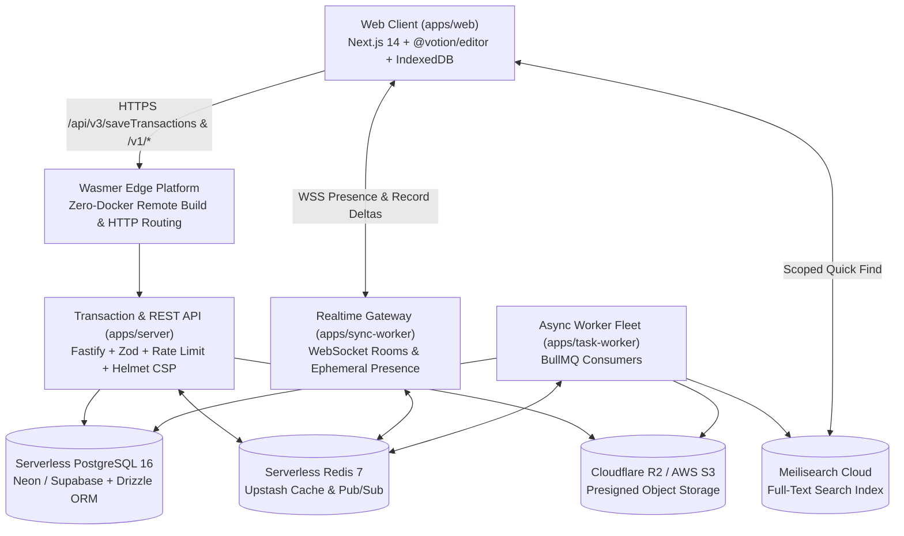

# Votion

**Open-Source, Local-First, End-to-End Collaborative Workspace on Wasmer Edge**

[](https://opensource.org/licenses/MIT)
[](https://nodejs.org/)
[](https://pnpm.io/)
[](https://wasmer.io/)

Votion is an open-source collaborative workspace and hybrid relational document graph inspired by Notion's internal engineering model. Every page, paragraph, database row, equation, and media embed is modeled as a canonical **Block**, backed by an optimistic IndexedDB local cache, atomic JSONB transaction streams, real-time WebSocket presence, and a zero-Docker **Wasmer Edge** deployment pipeline.

---

## Key Features

- **Block-Based Editor Canvas (`@votion/editor`)**
  - 25+ block types: Pages, Headings (`H1`–`H3`), Paragraphs, Bulleted & Numbered Lists, To-Do Checkboxes, Toggles, Quotes, Callouts, Dividers, Multi-Column Layouts, Code (syntax-highlighted), KaTeX Math, Images (resizable), Video/Audio/Files, Bookmarks, Sandboxed Embeds, and Synced Blocks.
  - `/` Slash Command catalog, floating inline formatting toolbar, Markdown auto-formatting shortcuts, 6-dot drag-and-drop handles, and multi-block lasso selection.
- **Relational Databases & 6 Projections (`@votion/database-engine`)**
  - **Table**, **Board (Kanban)**, **Calendar**, **Timeline (Gantt)**, **Gallery**, and **List** views over schema-backed Collections.
  - Compound `AND`/`OR` filter trees, multi-column sorting, groupings, sub-items, two-way **Relations**, **Rollups**, and a custom **Formula 2.0** lexer/parser/AST evaluator.
- **Local-First State & Offline Engine (`@votion/sync-client`)**
  - Normalized in-memory Zustand `RecordStore` hydrated from IndexedDB (Dexie.js).
  - Synchronous optimistic UI patching (`0ms` local latency) with a persistent offline `OutboxStorage` queue that replays atomic `saveTransactions` batches on reconnect.
- **Real-Time Collaboration & Presence (`apps/sync-worker`)**
  - Authenticated WebSocket gateway backed by Redis Pub/Sub (`space:<id>:events`) and ephemeral 10s-TTL cursor/block presence rooms.
- **Hierarchical Permissions & Public Sharing (`@votion/acl`)**
  - Workspace RBAC (`owner`, `admin`, `member`, `guest`), upward `parent_id` DAG permission traversal, explicit entity overrides, Redis ACL caching, and public slug publishing.
- **Instant Full-Text Search (`@votion/search`)**
  - `Cmd/Ctrl + K` Quick Find modal with typo-tolerant prefix search, breadcrumb extraction, fail-closed ACL filter scoping, and Meilisearch Cloud indexing.
- **Background Worker Fleet (`apps/task-worker`)**
  - BullMQ consumers for recursive soft-delete/permission cascades, Meilisearch ingestion, rollup recalculation, Sharp image thumbnails & OpenGraph scraping, and Markdown/CSV/PDF import-export pipelines.
- **Notion-Compatible `/v1` Developer API (`apps/server`)**
  - REST endpoints (`/v1/blocks`, `/v1/pages`, `/v1/databases`, `/v1/search`), SHA-256 scoped integration keys, HMAC-SHA256 signed webhooks (`X-Votion-Signature`), and event-driven database automations.
- **Edge Security Hardening**
  - Strict Content Security Policy (CSP) headers across Next.js and Fastify, trusted-host sandboxed embeds (YouTube, Figma, GitHub, CodePen), strict CORS origin validation, route-tiered rate limiting, and defense-in-depth Rich Text & KaTeX XSS sanitization.

---

## System Architecture



### Architectural Highlights

1. **Everything Is a Block**: Pages, text paragraphs, callouts, and database rows share a single canonical `blocks` table (`id`, `space_id`, `type`, `properties` JSONB, `format` JSONB, ordered `content` UUID[], `parent_table`, `parent_id`, `alive`).
2. **Command-Pattern Transactions**: Edits emit fine-grained operations (`set`, `update`, `listAfter`, `listBefore`, `listRemove`, `keyedObjectSet`) applied atomically in PostgreSQL and recorded in `transaction_records` (WAL) before fanning out over Redis Pub/Sub.
3. **Zero-Docker Edge Deployment**: Votion deploys directly to **Wasmer Edge** via `wasmer deploy --build-remote` configured by the root [`wasmer.toml`](./wasmer.toml) manifest — no Dockerfiles or local container daemons required.

---

## Monorepo Layout

```text
votion/
├── apps/
│   ├── web/                 # Next.js 14 App Router workspace UI shell
│   ├── server/              # Fastify transaction engine (/api/v3/*) & Notion REST API (/v1/*)
│   ├── sync-worker/         # WebSocket collaboration & ephemeral presence gateway
│   └── task-worker/         # BullMQ background workers (cascade, search, rollups, media, export)
├── packages/
│   ├── types/               # Canonical TypeScript data contracts & XSS/CSP security primitives
│   ├── db/                  # Drizzle ORM PostgreSQL 16 schema, indexes & migrations
│   ├── sync-client/         # Zustand RecordStore, Dexie IndexedDB cache & offline Outbox
│   ├── editor/              # Recursive block canvas, rich-text renderer, slash menu & DnD
│   ├── database-engine/     # 6 collection views, filter/sort/group engine, relations & Formula 2.0
│   ├── acl/                 # Hierarchical permission graph traverser, overrides & public gateway
│   └── search/              # Meilisearch indexer, ACL-scoped query builder & Cmd+K modal
├── tooling/
│   ├── eslint-config/       # Shared ESLint configurations
│   ├── typescript-config/   # Shared strict TypeScript configurations
│   └── wasmer/              # Automated Wasmer Edge remote deployment script (deploy.sh)
├── docs/
│   └── wasmer-deployment.md # Step-by-step Wasmer Edge production deployment guide
├── .github/workflows/       # GitHub Actions CI (PR checks) & CD (Wasmer Edge deploy)
└── wasmer.toml              # Wasmer Edge package manifest, capabilities & secret bindings
```

---

## Quickstart Guide

### Prerequisites

- **Node.js** `>= 20.0.0`
- **pnpm** `9.15.0` (enable via `corepack enable`)
- *(Optional for cloud-backed mode)* Neon/Supabase PostgreSQL 16, Upstash Redis 7, Cloudflare R2 / S3, Meilisearch Cloud

### 1. Clone & Install Dependencies

```bash
git clone https://github.com/Nexuss-Onyx/Votion.git
cd Votion
corepack enable
pnpm install
```

### 2. Configure Environment Variables

Copy `.env.example` to `.env` and populate any cloud service URLs you wish to connect (in local development and tests, `apps/server` and `apps/web` also support zero-config in-memory stores):

```bash
cp .env.example .env
```

### 3. Run the Development Workspace

```bash
pnpm dev
```

### 4. Build, Lint, Typecheck & Test

```bash
# Production build across all packages and apps
pnpm turbo run build

# Whole-monorepo ESLint & TypeScript verification
pnpm turbo run lint
pnpm turbo run typecheck

# Full unit & integration test suite (Vitest + Testing Library)
pnpm turbo run test
```

---

## Deploying to Wasmer Edge (Zero-Docker)

Votion uses **Wasmer Edge remote builds** (`--build-remote`) defined in [`wasmer.toml`](./wasmer.toml).

```bash
# 1. Validate manifest and deployment readiness (dry-run)
./tooling/wasmer/deploy.sh --dry-run

# 2. Authenticate and deploy remotely to Wasmer Edge
export WASMER_TOKEN="<YOUR_WASMER_TOKEN>"
./tooling/wasmer/deploy.sh
```

Automated production deployments also run on every push to `main` via [`.github/workflows/deploy.yml`](./.github/workflows/deploy.yml) using the `WASMER_TOKEN` GitHub Actions repository secret.

For full instructions on installing the Wasmer CLI, provisioning edge secrets (`DATABASE_URL`, `REDIS_URL`, `S3_ENDPOINT`, `S3_ACCESS_KEY`, `S3_SECRET_KEY`), and configuring custom domains, see the **[Wasmer Edge Deployment Guide](./docs/wasmer-deployment.md)**.

---

## Companion Documentation

- **[Architecture.md](./Architecture.md)** — System Architecture, Data Model DDL & Sync Protocols
- **[Components.md](./Components.md)** — Subsystem Decomposition & TypeScript Data Contracts
- **[docs/wasmer-deployment.md](./docs/wasmer-deployment.md)** — Production Deployment & Secret Management on Wasmer Edge
- **[CONTRIBUTING.md](./CONTRIBUTING.md)** — Developer Workflow, Coding Standards & PR Guidelines

---

## License

Released under the [MIT License](https://opensource.org/licenses/MIT).
